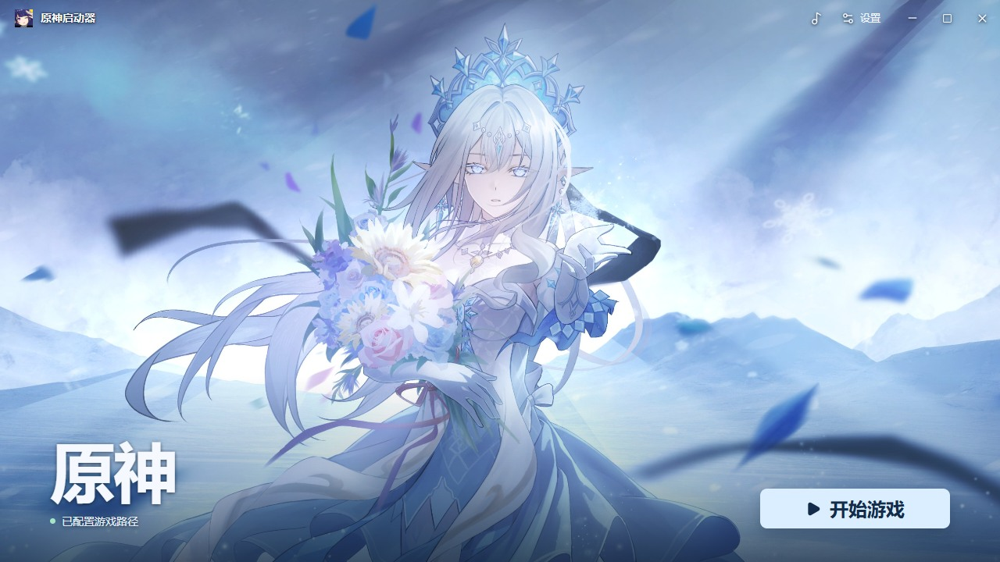
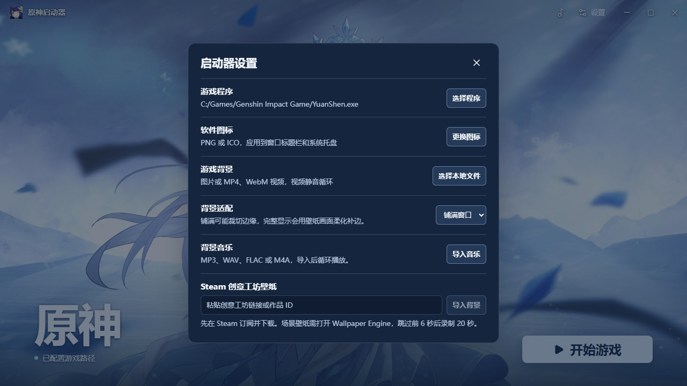
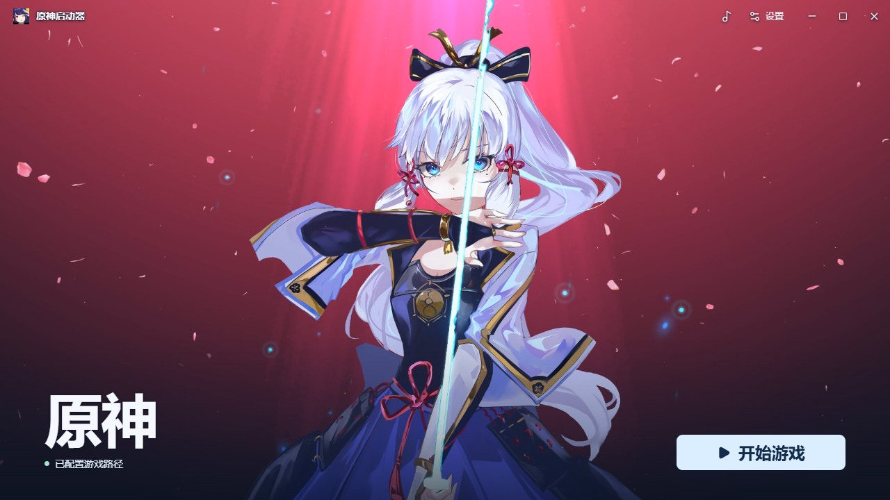

# 原神启动器

一个基于 **Tauri 2、Vue 3 和 Rust** 的 Windows 桌面启动器。它启动本机已安装的原神或米哈游官方启动器，并支持自定义背景、图标和音乐。

**[下载 v0.1.0 · Windows x64 EXE](https://github.com/wek486/genshin-launcher/releases/download/v0.1.0/genshin-launcher-v0.1.0-windows-x64.exe)** · [查看版本说明](https://github.com/wek486/genshin-launcher/releases/tag/v0.1.0)

下载后直接运行，首次使用时在「设置 → 选择程序」指定本机的原神或官方启动器。

## 界面展示



| 设置界面 | 动态壁纸示例 |
| --- | --- |
| [](desktop/docs/screenshots/settings.jpg) | [](desktop/docs/screenshots/wallpaper.jpg) |

动态壁纸示例来自 Wallpaper Engine 创意工坊作品 [《神里绫华·武士刀》](https://steamcommunity.com/sharedfiles/filedetails/?id=2685898597)（bai22331）。设置截图中的游戏路径为示例。

## 功能

- **游戏启动**：在设置中选择原神或官方启动器的 `.exe`。点击「开始游戏」，在 Windows UAC 弹窗中确认管理员授权。启动成功后自动暂停背景音乐并隐藏到系统托盘。
- **图片与视频背景**：支持 JPG、PNG、WebP、GIF、MP4 和 WebM。可选择「铺满窗口」或「完整显示」，后者使用同一画面柔化补边。标题栏透明，视频静音循环。
- **Steam 创意工坊壁纸**：输入 Wallpaper Engine 作品链接或 ID，导入本机已下载的视频壁纸。场景壁纸跳过前 6 秒，录制接下来的 20 秒作为循环背景。
- **背景音乐**：导入本地 MP3、WAV、FLAC 或 M4A，循环播放。标题栏的音乐按钮控制静音，重启后保留设置。
- **图标和托盘**：支持自定义 PNG、ICO 图标。左键点击托盘图标恢复窗口，右键菜单可退出启动器。

## 开发

需要 Windows、Node.js **22.12 或更新版本**、Rust stable（MSVC 工具链）、Visual Studio C++ Build Tools（含 Windows SDK）和 Microsoft Edge WebView2 Runtime。

```powershell
git clone https://github.com/wek486/genshin-launcher.git
cd genshin-launcher\desktop
npm ci
npm run tauri:dev
```

打开「设置 → 选择程序」，选择本机的游戏或官方启动器。运行 `npm run dev` 可以单独预览网页界面。文件选择、系统托盘和游戏启动功能在 Tauri 桌面窗口中使用。

## 构建 EXE

在 `desktop` 目录执行对应命令。

| 用途 | 命令 | 产物 |
| --- | --- | --- |
| 生成可直接运行的 EXE | `npm run tauri:build -- --no-bundle` | `src-tauri/target/release/desktop.exe` |
| 生成 Windows 安装包 | `npm run tauri:build` | `src-tauri/target/release/bundle/` |

覆盖构建前，从系统托盘右键退出正在运行的启动器，以释放 Windows 对 EXE 的占用。

## 导入 Wallpaper Engine 壁纸

Steam 视频壁纸和场景壁纸都需要先订阅并等待下载完成。导入场景时还需打开 Wallpaper Engine，并安装带 `gfxcapture` 和 `libx264` 的 Windows 版 FFmpeg。把 FFmpeg 加入 PATH，或将 `ffmpeg.exe` 和它依赖的 DLL 放入下列目录。

```text
%LOCALAPPDATA%\com.lenovo.desktop\workshop-tools\ffmpeg
```

录制过程中保持壁纸的独立播放窗口开启。FFmpeg 也用于识别视频文件中固定的黑边。

## 项目结构

| 目录 | 内容 |
| --- | --- |
| [`desktop/src`](desktop/src) | Vue 界面、背景和音乐播放 |
| [`desktop/src-tauri`](desktop/src-tauri) | Rust 后端、UAC 启动、系统托盘和壁纸导入 |
| [`desktop/docs/API.md`](desktop/docs/API.md) | Tauri IPC 命令与返回值 |

游戏路径、已导入的媒体和播放偏好保存在当前设备。仓库包含启动器源码和默认界面资源。
